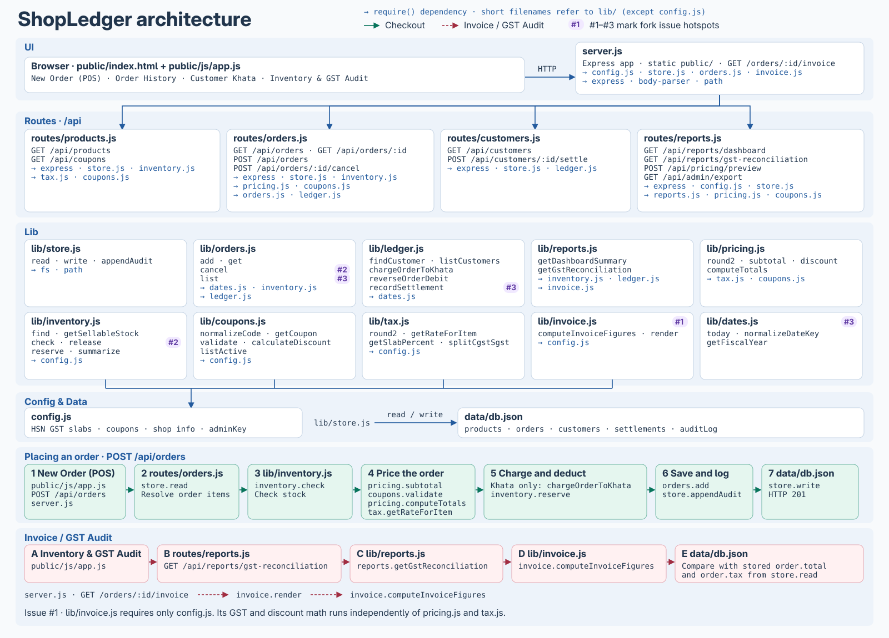

# ShopLedger: legacy codebase workshop

ShopLedger is a small Node.js + Express app for a kirana and wholesale shop. It has a POS, a Khata (customer credit) ledger, and GST tax invoices, and it stores everything in one JSON file (`data/db.json`). When this work started it had no tests, no README and three open bug tickets.

This fork fixes all three tickets. Each fix follows the same safe flow: **explain → diagram → pin current behaviour with tests → reproduce → failing test → smallest fix → review → pull request.** All of the work was done with OpenAI Codex.

## The three fixes

| Ticket | Pull request | What was wrong | Result |
|---|---|---|---|
| [#1](https://github.com/Naman9599-jpg/shopledger-legacy-workshop/issues/1) Invoice total and GST don't match what was billed | [PR #7](https://github.com/Naman9599-jpg/shopledger-legacy-workshop/pull/7) | The printed invoice used its own maths: an 18% fallback instead of the HSN slab, the discount applied after GST, and no coupon cap | GST Audit mismatches **7 → 0**. Order #1002 prints **₹963.90**, what was billed, instead of ₹1,083.24 |
| [#2](https://github.com/Naman9599-jpg/shopledger-legacy-workshop/issues/2) Can't sell the last unit; cancel never restores stock | [PR #8](https://github.com/Naman9599-jpg/shopledger-legacy-workshop/pull/8) | An off-by-one (`>=`) in the stock check, and cancel called the wholesale-hold helper instead of restocking | The last Ghee jar sells. Cancelling #1007 restores stock (Ghee 1 → 3, Oil 22 → 24) |
| [#3](https://github.com/Naman9599-jpg/shopledger-legacy-workshop/issues/3) Order history order and date filter broken; Khata settlements corrupt balances | [PR #9](https://github.com/Naman9599-jpg/shopledger-legacy-workshop/pull/9) | Dates were compared as `DD/MM/YYYY` strings (day first), and a settlement amount sent as text was concatenated (`1200 + "500"` → `1200500`) | Newest first, 1008 → 1001. The January filter returns exactly #1004, #1003, #1002. Meera's ₹500 settlement gives 1,700 settled and ₹732.01 owed |

Each PR has **two commits: characterization tests first, then the fix.** Each one changes only the files its ticket needs.

## Edge cases these fixes also handle

- **Expired coupons on old invoices (#1).** Simply re-running today's coupon rules would drop the discount once a coupon expires. A ₹944 DIWALI20 bill would reprint as ₹1,180. The invoice reprints the **discount that was actually billed**, through a small pure extraction in `lib/pricing.js` (`computeTotalsWithDiscount`), so checkout itself is unchanged.
- **Auditable invoice (#1).** Each line shows Gross → Discount → Taxable → GST % → GST amount, with separate CGST and SGST totals.
- **Duplicate cart lines (#2).** Stock is checked against the **total** quantity per product, so two lines of the same item can't oversell. Wholesale holds (`reserved`) are never released by a normal order cancel.
- **Bad or old settlement data (#3).** Text, NaN, zero and negative amounts are rejected without changing anything. Settled totals that are already stored as text are converted before adding. Amounts are rounded to paise.

## Architecture



The source is in [`docs/architecture.svg`](docs/architecture.svg). Purple badges mark where each ticket lives. The green strip is the checkout flow, and the red dashed strip is the invoice / GST Audit flow behind ticket #1.

## Run it

Requires Node.js 22+.

```bash
npm install
npm start          # http://localhost:3000  (set PORT to use another port)
```

Placing orders changes `data/db.json`. Undo that with `git checkout data/db.json`.

## Run the tests

The tests live on the fix branches and use Node's built-in test runner (no extra dependencies). They use in-memory copies of the data and never touch `data/db.json`.

```bash
git checkout fix/invoice-gst-mismatch                    # PR #7: 25 tests
node --test

git checkout fix/inventory-last-unit-and-cancel-restock  # PR #8: 18 tests
node --test

git checkout fix/order-dates-and-khata-settlement        # PR #9: 26 tests
node --test
```

All three branches merge together without conflicts, and the combined suite passes 69 of 69.

## Working rules

[`AGENTS.md`](AGENTS.md) holds the standing rules used for every change:
- characterization tests before changing behaviour
- one ticket's modules per change
- tests never touch `data/db.json`
- no new dependencies

## Known follow-ups (out of scope for these tickets)

- `config.js` hard-codes the admin export key, and `/api/admin/export` accepts it in the query string.
- The dashboard builds HTML with `innerHTML` from customer and product names, which allows stored HTML injection.
- `data/db.json` is rewritten on every request, with no locking or atomic replace.
- Checkout rounds each line's share of a discount separately, so on some orders the line discounts can differ from the total discount by a paise.
